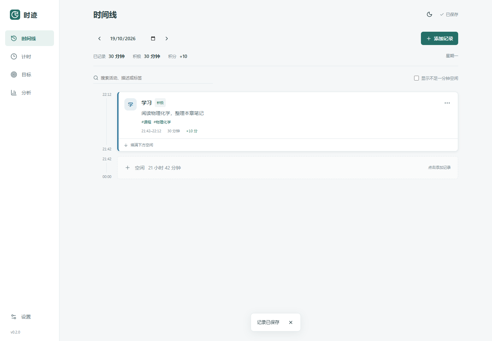

# 时迹 · Open Timelog

参考 UpTimer 交互理念、独立编写的开源离线时间记录应用，MIT 许可。
主界面只有**时间线、计时、目标、分析**四个面板。支持 Windows、macOS、Android
与响应式网页 / PWA，浅色、暗色与跟随系统外观。

[下载最新版](https://github.com/AlexbeatsZ/open-timelog/releases/latest) ·
[使用说明](docs/user-guide.md) · [AI API](docs/api.md) ·
[参考分析与边界](docs/research/uptimer.md) ·
[问题反馈](https://github.com/AlexbeatsZ/open-timelog/issues)



## 四个面板

- **时间线**：最新时间在上，记录和空闲都是卡片。点空闲补记；记录可向上/下填满
  相邻空白。支持日期、描述、标签、搜索、编辑、软删除恢复和跨日片段。
- **计时**：点活动开始，进入计时页；暂停、继续、专注，结束自动加入时间线。
  可从上条记录结束处开始。活动管理放在本面板内。
- **目标**：每日/每周活动时长，自动计算进度、剩余时间与达标状态。
- **分析**：当日/7/30 天趋势、活动时长、积分与记录数。积分只做反馈统计，暂无商店。

设置中提供 JSON 备份、导入预览、合并/完整恢复、CSV、Markdown 导出及本机 API 信息。
无需账号、遥测、网络字体或云服务；当前使用手动 JSON 跨设备迁移。

## 下载与运行

从 [GitHub Releases](https://github.com/AlexbeatsZ/open-timelog/releases/latest) 下载：

| 平台 | 包 | 运行方式 |
| --- | --- | --- |
| Windows x64 | `Open-Timelog-0.2.0-Windows-x64.zip` | 完整解压后运行 Open Timelog.exe |
| macOS Apple Silicon | `Open-Timelog-0.2.0-macOS-arm64.zip` | 解压得到 .app |
| macOS Intel | `Open-Timelog-0.2.0-macOS-x64.zip` | 解压得到 .app |
| Android 7+ | `Open-Timelog-0.2.0-Android.apk` | 安装 APK，数据保存在应用内 |
| 网页 / PWA | `Open-Timelog-0.2.0-web.zip` | 部署到 HTTPS 或 localhost 静态站点 |

macOS 当前仅 ad-hoc 本地签名，未做 Developer ID 签名与 Apple 公证；首次打开可能被
Gatekeeper 阻止。遵循系统自己的安全提示与允许流程，本项目不修改系统安全策略。
Android 暂无持续通知或前台服务；重新打开后按持久时间戳恢复计时。

更新前在「设置 → 备份与导出」导出 JSON，关闭旧版后解压新版。复制程序不等于迁移数据；
各设备、浏览器和桌面端数据相互独立。0.1 的 v1 备份仍可读，历史奖励字段保留。

## 本机 AI 接口

打开 Windows/macOS 桌面版后，本机 AI 可通过鉴权 REST API 查询/写入活动、记录、计时、
目标、时间线与统计。`api.json` 自动发现真实端口和凭据，CLI 不打印令牌：

```powershell
node scripts/api.mjs GET /v1/activities
node scripts/api.mjs GET /v1/timeline
node scripts/api.mjs POST /v1/timer/start --data-file start.json
```

详见 [接口文档](docs/api.md) 和 [OpenAPI](public/openapi.json)。HTTP 服务仅监听
127.0.0.1，不提供任意脚本、shell、文件访问或完整状态覆盖。

## 源码开发

需要 Node.js 24 LTS 与 npm；Android 另需 JDK 21、Android SDK 36，macOS 打包需在 Mac 运行。

```powershell
git clone https://github.com/AlexbeatsZ/open-timelog.git
cd open-timelog
npm ci
npm run dev
npm run desktop
npm run check
npm test
npm run test:e2e
npm run package:win
npm run package:mac
node scripts/init-android-signing.mjs
npm run package:android
```

Android 签名保存在忽略目录 `.local/`；后续更新需保留同一密钥，不提交或上传它。
已有代理时可为当前进程设置 `ELECTRON_GET_USE_PROXY=1`，无需修改系统环境。
开发桌面数据在 `.runtime/desktop`，测试使用独立临时 profile，发行包不含测试或研究数据。

## 范围

目前没有自动同步、原版备份兼容、计划/流程、倒计时、系统提醒、定位/NFC 或 iOS 安装包。
Android 真机触控与生命周期、Intel Mac 实际运行和 Apple 公证须单独验收。
静态分析只读取原版安装包元数据及交互字符串；没有复制原版代码、图标、字体或资源。

反馈问题请提供平台、版本和操作步骤，只附脱敏样本；不要上传完整记录、连接令牌或签名材料。
